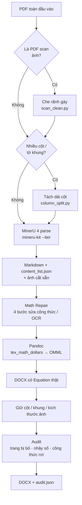
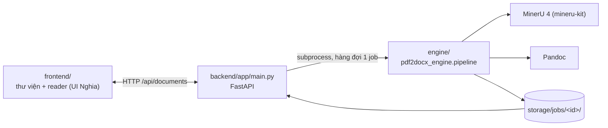

# MatchPDF

## NGHIÊN CỨU, CẢI TIẾN KHẢ NĂNG XỬ LÝ VÀ TRÍCH XUẤT NỘI DUNG CÔNG THỨC TOÁN TỪ TÀI LIỆU PDF

**Môn học:** Công nghệ lập trình hiện đại — SGU, HK1 2026–2027

---

## 1. Vấn đề nghiên cứu

PDF giữ được hình dạng trang in nhưng gần như không chỉnh sửa lại được. Với tài liệu toán, **công thức** là phần hỏng đầu tiên khi chuyển định dạng, vì PDF không lưu "công thức" — nó chỉ lưu từng ký tự ở một toạ độ.

Một pipeline ngây thơ (trích text → đổi đuôi thành `.docx`) hỏng ở sáu điểm, và đó chính là sáu nhóm cải tiến của đồ án:

| Nhóm lỗi | Biểu hiện thực tế |
|---|---|
| Cấu trúc trang | Cheat sheet nhiều cột bị đọc thành **một bảng khổng lồ**, mất thứ tự đọc theo cột |
| Nhiễu từ bản scan | Ảnh chụp sách lộ **trang bên kia** qua rãnh gáy → chèn dòng cụt vào giữa đề bài |
| Công thức bị xé | `x$^{7}$` tách rời thành chữ `x` + công thức `$^{7}$` → Word hiện "x ⁷" lệch font |
| Ký hiệu LaTeX lạ | `{\bf X}` khiến Pandoc không hiểu → công thức **rơi về text thô**, không thành Equation |
| Công thức quá cao | Hệ phương trình nằm inline bị Word **cắt mất dòng đầu** |
| Không kiểm soát được | Không biết trang nào bị bỏ, chỗ nào mất công thức — lỗi âm thầm |

Mục tiêu của đồ án: **đo được** chất lượng trích xuất, không chỉ "trông giống PDF".

---

## 2. Cải tiến đã cài đặt

Tất cả các bước dưới đây chạy **offline**, không cần GPU, không viết cứng cho một file PDF cụ thể — mọi ngưỡng đều dò từ chính hình học / lớp chữ của PDF đầu vào.

### 2.1. Tiền xử lý trang

| Cải tiến | Cách làm | File |
|---|---|---|
| Che rãnh gáy bản scan | Dò cột tối hẹp có phía ngoài sáng hơn hẳn → tô trắng phần ngoài rãnh | `engine/src/pdf2docx_engine/pdf/scan_clean.py` |
| Tách dải cột cho cheat sheet | Dò đường kẻ dọc dài gần bằng đường dài nhất → cắt thành các dải, cho MinerU đọc từng cột như tài liệu 1 cột | `engine/src/pdf2docx_engine/pdf/column_split.py` |
| Chạy song song | Chia PDF thành N dải trang liên tiếp, N tiến trình MinerU cùng lúc, ghép lại theo `page_idx` | `engine/src/pdf2docx_engine/recognition/parallel_mineru.py` |

### 2.2. Sửa công thức trên Markdown

`engine/src/pdf2docx_engine/math/math_repair.py` chạy 4 bước thuần regex + thống kê:

1. **`merge_fragmented_math`** — gộp `x$^{7}$` → `$x^{7}$`, `(1+x)$^{11}$` → `$(1+x)^{11}$`.
2. **`fix_problem_labels`** — dựa vào dãy số thứ tự liên tiếp của đề bài để sửa `nǐ 52`, `Bai 52`, `Pai 54` → `Bài 52.`, `Bài 53.`, `Bài 54.`
3. **`fix_diacritics_by_context`** — bỏ phiếu theo ngữ cảnh toàn tài liệu + từ điển thuật ngữ toán: `Tím hệ số` → `Tìm hệ số`.
4. **`promote_tall_inline_math`** — công thức inline có hệ/ma trận nhiều dòng → display math, tránh Word cắt dòng đầu.

### 2.3. Dựng DOCX giữ đúng hình dạng PDF

| Cải tiến | Cách làm | File |
|---|---|---|
| Equation OMML thật | Pandoc với `tex_math_dollars` → `m:oMath`, công thức chỉnh sửa được trong Word | `engine/src/pdf2docx_engine/docx/build_docx.py` |
| Chuẩn hoá LaTeX legacy | `{\bf X}` → `\mathbf{X}` trước khi Pandoc đọc | `engine/src/pdf2docx_engine/docx/build_docx.py` |
| Giữ bố cục nhiều cột | Đặt section N cột + chèn ngắt cột đúng chỗ mỗi cột PDF kết thúc | `engine/src/pdf2docx_engine/docx/columns.py` |
| Giữ khung + tiêu đề mục | Dựng lại viền trang, kẻ cột, banner lặp đầu trang, thanh tiêu đề mục | `engine/src/pdf2docx_engine/docx/frame_layout.py` |
| Kích thước ảnh đúng PDF | MinerU cắt ảnh ở 200 dpi nhưng Pandoc đoán 96 dpi → ảnh to gấp ~2 lần; thêm `{width=..in}` | `engine/src/pdf2docx_engine/docx/image_size.py` |

### 2.4. Kiểm soát chất lượng

`engine/src/pdf2docx_engine/audit.py` chạy ba phép kiểm tra sau khi dựng DOCX và ghi `audit.json`:

- **`dropped_pages`** — đọc log MinerU, tìm trang bị `dropped=N` (khối nội dung bị bỏ).
- **`numbering_gaps`** — phát hiện đề bài / ý nhỏ nhảy số (`Bài 53` mất, `11a) 11c)` thiếu `b)`).
- **`docx_math_failures`** — quét `document.xml`, tìm LaTeX còn sót thành chữ thường (`\frac`, `\left`, `$`) = công thức Pandoc không đổi được.

Điểm cốt lõi: hệ thống **không** đoán công thức từ ảnh OCR thô. Nó lấy `content_list.json` của MinerU (đã có `type`, `page_idx`, `bbox`, LaTeX) làm nguồn sự thật duy nhất, rồi dựng cả DOCX lẫn báo cáo kiểm tra từ cùng nguồn đó.

---

## 3. Luồng xử lý





---

## 4. Model và công nghệ đang chạy

Số liệu đo trực tiếp trên máy phát triển ngày 2026-10-26.

| Thành phần | Đang dùng | Phiên bản | Vai trò |
|---|---|---|---|
| Parse PDF | MinerU `mineru-kit` | **4.0.12** | Markdown, `content_list.json`, cắt ảnh |
| Tier parse | `advanced` (mặc định) | — | Chất lượng công thức cao nhất; đổi bằng `--tier` hoặc `MINERU_TIER` |
| Thiết bị suy luận | `mps` | — | Apple Silicon GPU |
| Worker | 2 tiến trình song song | — | Chia dải trang, chạy đồng thời |
| Công thức → Word | Pandoc `texmath` | **3.11** | LaTeX → OMML Equation |
| Sửa lỗi công thức | Regex + thống kê tự cài | — | Không model, không GPU |
| Runtime | Python | **3.13.14** | |

**Kiểm chứng lại:**

```bash
.venv/bin/mineru-kit version     # → MinerU version: 4.0.12
pandoc --version | head -1       # → pandoc 3.11
python3 --version                # → Python 3.13.14
```


---

## 5. Cấu trúc repo

```text
engine/                      Lõi xử lý, không phụ thuộc web
  src/pdf2docx_engine/
    pipeline.py              convert(pdf, out_dir) + CLI
    config.py                tier MinerU, cờ Pandoc, thư mục storage
    audit.py                 kiểm tra chất lượng -> audit.json
    pdf/                     scan_clean, column_split (tiền xử lý PDF)
    recognition/             run_mineru, parallel_mineru (OCR), diacritic_fusion + vision_ocr.swift (ghép OCR),
                             vi_correct (bmd1905) + vietnam (nrl-ai thêm dấu)
    math/                    math_repair (sửa công thức trên Markdown)
    docx/                    build_docx, columns, frame_layout, image_size
  tests/
backend/                     FastAPI: thư viện tài liệu + hàng đợi chạy engine
  app/main.py                route /api/documents, /api/health, /api/system/stats
  app/jobs.py                kho job (storage/jobs/<id>/), chạy engine, dựng JSON cho UI
  app/errors.py              lỗi trả {"error": {"code", "message"}}
  tests/
frontend/                    UI "vở toán" (nhánh Nghia): index.html, reader.html, app.js, config.js, style.css
storage/                     Kết quả chạy (bị gitignore)
```

Engine không biết gì về web; backend chỉ gọi `python -m pdf2docx_engine.pipeline` như người dùng gõ trong terminal, nên mọi kết quả trên UI đều tái lập được bằng CLI.

---

## 6. Cách chạy

Cần sẵn: Python ≥ 3.10, `pandoc`, `tesseract` (dò cột), MinerU 4 (`mineru-kit`).

PDF scan: mặc định bật **ghép OCR** (`recognition/diacritic_fusion.py`) — MinerU giữ bố cục/công thức, chữ được
bỏ phiếu lại bởi Tesseract (`vie`) + Apple Vision (macOS, 300 và 400 DPI) + từ điển Viet74K (tải về cache, GPL-2.0,
không đóng gói); chỗ bất đồng được cắt sát dòng và đọc lại; sửa dấu đặt sai chỗ; bỏ chữ lọt từ mép trang bên cạnh.
Mọi chỗ các bộ OCR không thống nhất ghi trong `ocr_fusion_report.json`.

| Đo trên sách AAA (đáp án gõ tay từ ảnh trang) | Bản kiet | Ghép OCR |
|---|---|---|
| 6 trang dùng khi tinh chỉnh (3.192 chữ) | 6,74% sai | 0 |
| 2 trang mới chưa dùng (1.131 chữ) | 8,49% sai | 0 |
| 36 dòng rải rác (891 chữ) | 5,27% sai | 0,22% |

Cài: `brew install tesseract tesseract-lang`. Windows/Linux: chỉ Tesseract (không có Apple Vision).
Tắt: `--no-ocr-fusion` (ra y hệt `main.py` nhánh kiet).

```bash
python -m venv .venv && source .venv/bin/activate
pip install -r requirements.txt -r backend/requirements.txt   # requirements.txt = của nhánh kiet
export PYTHONPATH=$PWD/engine/src                              # hoặc: pip install --no-deps -e engine

# CLI
python -m pdf2docx_engine.pipeline --pdf bai_giang.pdf          # -> storage/runs/<ten>_<doc_id>/
python -m pdf2docx_engine.pipeline --pdf bai_giang.pdf --tier standard --workers 1 --out /tmp/x
python -m pdf2docx_engine.pipeline --pdf bai_giang.pdf --vi-correct   # thêm dấu (vietnam.py) + sửa chính tả (vi_correct.py)

# Web: backend phục vụ luôn frontend/
uvicorn backend.app.main:app --port 8000                        # mở http://127.0.0.1:8000

# Test
pytest engine/tests backend/tests
```

| Method | Đường dẫn | Mô tả |
|---|---|---|
| `POST` | `/api/documents` | multipart `files` (nhiều PDF ≤ 100 MB), `tier` (mặc định `advanced`), `workers` (1–8) → 202 |
| `GET` | `/api/documents?limit=200` | Thư viện tài liệu, mới nhất trước |
| `GET` | `/api/documents/{id}` | Trạng thái, shards MinerU, timeline từng bước, lỗi |
| `PATCH` | `/api/documents/{id}` | Đổi tên hiển thị |
| `DELETE` | `/api/documents/{id}` | Xóa tài liệu + toàn bộ file kết quả |
| `POST` | `/api/documents/{id}/cancel` | Hủy tài liệu đang chạy/chờ |
| `POST` | `/api/documents/{id}/retry?force=true` | Chạy lại; mặc định tiếp tục phần MinerU đã xong |
| `GET` | `/api/documents/{id}/docx` | Tải DOCX khi `status = done` |
| `GET` | `/api/documents/{id}/pdf` | PDF gốc cho khung xem của `reader.html` |
| `GET` | `/api/health`, `/api/system/stats` | Công cụ cài đủ chưa / hàng đợi đang chạy |

Job chạy tuần tự (MinerU ngốn RAM/CPU). Mỗi job nằm trong `storage/jobs/<id>/` (`input.pdf`, `job.json`, `log.txt`, `out/`); id được kiểm bằng regex nên không path traversal được. Tải lại đúng file đã chuyển xong thì dùng lại DOCX cũ (`cache_hit`), không chạy MinerU lần nữa.

---

## 7. Giới hạn đã biết

- **Rãnh gáy:** chỉ bắt được trường hợp có rãnh tối rõ. Chữ lộ qua giấy ở mép **không** có rãnh tối (đã thử trên 95 trang `Toan11`: che được 47 trang) thì chưa tách được bằng heuristic đơn giản.
- **Chưa có ground truth** trong repo nên chưa có số CER/WER/PER của đồ án.
- **Công thức mờ / mất nét** trong bản scan có thể không phục hồi được. Hệ thống ghi cảnh báo vào `audit.json` thay vì tự bịa nội dung.
- **Phụ thuộc bên ngoài:** thiếu `pypdfium2`/`pdftoppm`, `tesseract` hoặc `opencv` thì bước dò cột tự rơi về chế độ "chia cột liên tục", không báo lỗi.

---

## 8. Hands-On Lab (thực hành nhanh, engine chạy là được)

### 8.1. Giới thiệu và mục tiêu học tập

Xong lab này bạn làm được 3 việc: chạy pipeline từ terminal, gọi API backend, đọc `audit.json` để biết trang nào rớt.
Không cần hiểu hết MinerU/Pandoc — chỉ cần thấy luồng `PDF → Markdown → DOCX → audit` chạy qua tay mình.

### 8.2. Chuẩn bị môi trường và công cụ

Khởi tạo dự án (chạy 1 lần, đang ở nhánh `main`):

```bash
python -m venv .venv && source .venv/bin/activate
pip install -r requirements.txt -r backend/requirements.txt
export PYTHONPATH=$PWD/engine/src
.venv/bin/mineru-kit version     # kỳ vọng: MinerU version: 4.0.12
pandoc --version | head -1       # kỳ vọng: pandoc 3.11
python3 --version                # kỳ vọng: Python 3.13.x
```

Chụp màn hình 1: terminal hiện đủ 3 dòng version trên.

### 8.3. Kiến trúc và luồng xử lý

Nhớ đúng 1 câu: **engine không biết gì về web; backend chỉ gọi engine bằng subprocess như bạn gõ CLI.**

```text
PDF → scan_clean/column_split → MinerU (parallel_mineru)
    → math_repair (merge_fragmented_math, fix legacy {\bf X})
    → Pandoc (tex_math_dollars → OMML) → DOCX
    → audit.py (dropped_pages, numbering_gaps, docx_math_failures)
```

Nguồn sự thật duy nhất là `content_list.json` của MinerU (có `type`, `page_idx`, `bbox`, LaTeX).

### 8.4. Các bước thực hành và Starter Code

Bước 1 — test nhỏ (không cần PDF, không cần GPU, < 1 giây):

```bash
PYTHONPATH=$PWD/engine/src .venv/bin/python -m pytest engine/tests/test_engine.py::test_merge_fragmented_math backend/tests/test_api.py::test_health_and_stats -v
```

Bước 2 — starter code sửa công thức (copy chạy ngay):

```bash
export PYTHONPATH=$PWD/engine/src
.venv/bin/python -c "
from pdf2docx_engine.math.math_repair import merge_fragmented_math
from pdf2docx_engine.docx.build_docx import fix_legacy_tex_bf
md, n = merge_fragmented_math('Khai triển x\$^{7}\$ và (1+x)\$^{11}\$')
print(md, '| n =', n)            # kỳ vọng: \$x^{7}\$ ... n = 2
print(fix_legacy_tex_bf('\${\\\\bf X}\$'))  # kỳ vọng: \$\\\\mathbf{X}\$
"
```

Bước 3 — chạy nhanh backend + engine (không parse PDF thật):

```bash
.venv/bin/python -m pytest engine/tests backend/tests -q   # kỳ vọng: 20 passed
PDF2DOCX_STORAGE=$(mktemp -d) PYTHONPATH=$PWD .venv/bin/python -c "
from fastapi.testclient import TestClient
import backend.app.main as m
c = TestClient(m.app)
print(c.get('/api/health').json())   # kỳ vọng: {'ok': True, 'engine_found': True, ...}
"
```

Bước 4 — chạy thật 1 PDF (tốn phút, MinerU ngốn RAM, job chạy tuần tự):

```bash
python -m pdf2docx_engine.pipeline --pdf bai_giang.pdf --tier standard --workers 1 --out /tmp/lab_out
ls /tmp/lab_out   # kỳ vọng: *.docx + audit.json + ảnh cắt
```

Chụp màn hình 2: `20 passed` + JSON `/api/health`. Chụp màn hình 3: thư mục output có DOCX và `audit.json`.

### 8.5. Kết quả mong đợi và cách kiểm chứng

| Kiểm chứng | Lệnh | Kết quả đúng |
|---|---|---|
| Starter công thức | bước 2 ở trên | `$x^{7}$`, `$(1+x)^{11}$`, `\mathbf{X}` |
| Test nhỏ | `pytest engine/tests backend/tests -q` | `20 passed in ~0.3s` |
| Backend sống | `GET /api/health` | `{"ok": true, "engine_found": true, "tier": "advanced"}` |
| DOCX thật | mở file output | công thức là Equation sửa được, không phải ảnh |
| Audit | `cat audit.json` | có 3 khóa `dropped_pages`, `numbering_gaps`, `docx` |

Đọc `audit.json` mẫu trong `test_done_document_renders_audit_note`: `equations: 12`, `raw_latex_paragraphs: 2` kèm warning "bỏ khối" = trang 3 bị MinerU bỏ 1 khối.

### 8.6. Bài tập thực hành kèm đáp án

**BT1.** `x$^{7}$` gộp thành gì? Gõ `merge_fragmented_math("Khai triển x$^{7}$")` cho kết quả nào?
<details><summary>Đáp án</summary>`$x^{7}$`, `n >= 1`. Lý do: regex gộp chữ đứng trước `$^{...}$` vào trong math (xem `test_merge_fragmented_math`).</details>

**BT2.** `${\bf X}$` qua Pandoc bị gì, sửa sao?
<details><summary>Đáp án</summary>Rơi về text thô. Sửa bằng `fix_legacy_tex_bf` → `$\mathbf{X}$` rồi mới đưa cho Pandoc (xem `test_fix_legacy_bf`).</details>

**BT3.** `POST /api/documents` với file `b"hello"` và `tier="x"` trả gì?
<details><summary>Đáp án</summary>`400 UPLOAD_REJECTED` và `400 INVALID_TIER` (xem `test_rejects_non_pdf`, `test_rejects_bad_tier`). Engine không bao giờ được gọi vì backend chặn từ đầu.</details>

**BT4.** Job `done` nhưng thiếu DOCX, `GET /{id}/docx` trả gì? Vì sao `audit.json` vẫn quan trọng?
<details><summary>Đáp án</summary>`409` (xem `test_list_rename_delete`). Audit cho biết trang nào bị bỏ / công thức nào Pandoc không đổi được, thay vì lỗi im lặng.</details>

### 8.7. Lỗi thường gặp và cách khắc phục

| Lỗi | Dấu hiệu | Cách sửa |
|---|---|---|
| Quên `PYTHONPATH` | `ModuleNotFoundError: pdf2docx_engine` | `export PYTHONPATH=$PWD/engine/src` rồi chạy lại |
| Quên activate `.venv` | `mineru-kit: command not found` | `source .venv/bin/activate`, kiểm tra `.venv/bin/mineru-kit version` |
| Thiếu `pandoc` | `PANDOC_FAILED` trong job | `brew install pandoc` (macOS), chạy lại với `--tier standard --workers 1` |
| Thiếu `tesseract` | cột dò sai, chữ scan xấu | `brew install tesseract tesseract-lang`; muốn chạy nhanh thì tắt ghép OCR: `--no-ocr-fusion` |
| Port 8000 bận | `uvicorn` báo address in use | `uvicorn backend.app.main:app --port 8001` |
| Upload bị `400` | `UPLOAD_REJECTED` / `INVALID_TIER` | file phải bắt đầu bằng `%PDF`, tier chỉ nhận `standard`/`advanced` |
| Retry/cancel báo `409` | job đã `done` | đúng hành vi (xem `test_retry_requires_failure`): tạo job mới thay vì retry job xong |

### 8.8. Tổng kết và hướng mở rộng

Bạn đã đi hết vòng `PDF → DOCX → audit` bằng cả CLI và API. Từ đây có thể mở rộng: thêm 1 golden test cho `math_repair` với đề thi của bạn, cắm thêm 1 check mới vào `audit.py` (ví dụ đếm ảnh thiếu file), hoặc cho backend chạy 2 job song song khi máy đủ RAM. Giữ nguyên tắc của repo: mọi ngưỡng dò từ chính PDF đầu vào, không viết cứng cho một file cụ thể.
# PDF_TOAN_SANG_DOCX
